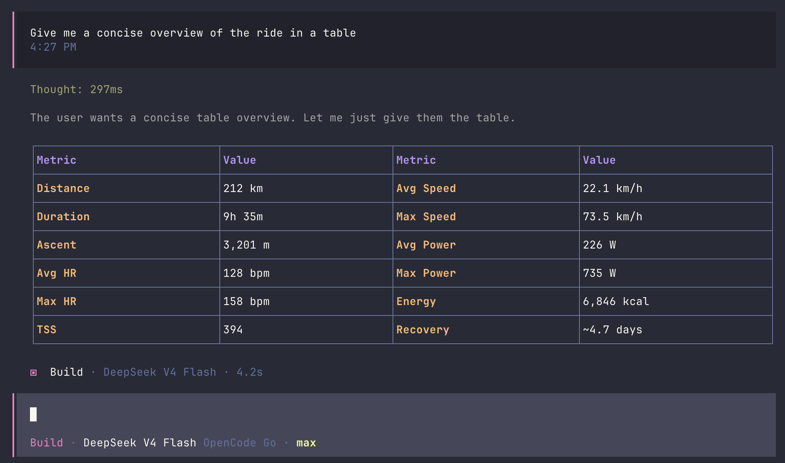
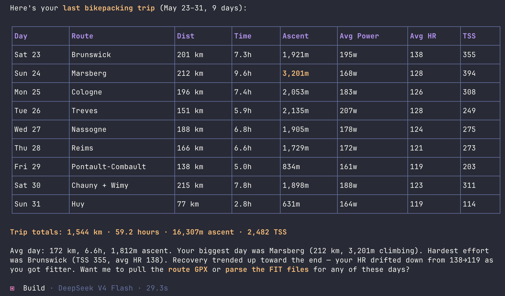

# Suunto MCP

[](https://github.com/jb381/suunto-mcp/actions/workflows/ci.yml)

Turn your Suunto history into something you can actually talk to.

Suunto MCP is a Rust MCP server for Suunto Cloud API
workouts, routes, and 24/7 activity, sleep, and recovery data. It gives MCP
clients a practical, quota-aware way to explore training data, with supporting
tools for local FIT/GPX files, Apple Health exports, and Suunto webhook
workflows when you want more than the cloud API alone.

<p>
  
  
</p>

## What You Can Do

- Ask for recent workouts, full workout details, FIT downloads, and parsed
  workout summaries.
- Compare activity, sleep, recovery, and daily 24/7 statistics without burning
  through Suunto's weekly API quota by accident.
- Export and inspect routes as GPX.
- Receive Suunto webhooks, verify HMAC signatures, store events locally, and
  decide which follow-up fetch is worth making.
- Parse local FIT, GPX, CSV/TSV, normalized JSON, and Apple Health `export.xml`
  files, even without Suunto API credentials.
- Enable write tools only when you intentionally want route imports, workout
  uploads, SuuntoPlus Guide mutations, or workout add-info calls.

Write/push tools stay off unless you explicitly set
`SUUNTO_ENABLE_WRITE_TOOLS=true`.

## Quick Start

Requirements

- Rust 1.96 or newer
- Suunto API Zone credentials for cloud access

Local file parsing works without Suunto credentials, so you can kick the tires
before wiring up cloud access.

```bash
git clone https://github.com/jb381/suunto-mcp.git
cd suunto-mcp
cargo build --locked --release
cp .env.example .env
```

Edit `.env`:

```env
SUUNTO_CLIENT_ID=your_client_id
SUUNTO_CLIENT_SECRET=your_client_secret
SUUNTO_REDIRECT_URI=http://localhost:8080/callback
SUUNTO_SUBSCRIPTION_KEY=your_subscription_key

SUUNTO_TOKEN_STORE=keyring
SUUNTO_API_CALLS_PER_MINUTE=10
SUUNTO_API_WEEKLY_CALL_LIMIT=200
```

In Suunto API Zone, set the OAuth redirect URI to exactly the same value as
`SUUNTO_REDIRECT_URI`.

Run the stdio MCP server:

```bash
./target/release/suunto-mcp
```

## Docker

Build and run the server as a container for headless / production deployments:

```bash
docker build -t suunto-mcp .
docker run -d --name suunto-mcp \
  --memory 256m --memory-swap 256m \
  -p 8000:8000 \
  --env-file .env \
  -e SUUNTO_TOKEN_STORE=file \
  -e SUUNTO_LOCAL_DATA_DIR=/data/data \
  -e SUUNTO_EXPORT_DIR=/data/exports \
  -e SUUNTO_API_QUOTA_FILE=/data/api-quota.json \
  -v suunto-mcp-data:/data \
  suunto-mcp
```

The image ships with headless-friendly defaults:

- **Token storage**: `file` instead of `keyring` (no desktop session needed)
- **Data paths**: all persistent state lives under `/data` (tokens, quota ledger, exports, webhook store) — mount a volume there
- **Transport**: streamable HTTP on port 8000
- **API token required**: Binding HTTP on `0.0.0.0` requires setting `SUUNTO_MCP_API_TOKEN` in your `.env` file — the server will refuse to start without it. Use a strong random value and keep it secret.

### docker compose

A ready-to-use `docker-compose.yml` lives in the repository root. Create your
`.env` file (copy from `.env.example`), then:

```bash
docker compose up -d
```

Set `SUUNTO_MCP_API_TOKEN` in `.env` before starting Compose. Compose uses a 256 MiB
memory limit with container swap disabled. Its health check sends an
unauthenticated `GET /health`, which returns `{"status":"ok"}` without creating
an MCP session or checking Suunto Cloud availability.

The Rust image reads the existing named volume in place. It uses the same
`/data/tokens.json`, `/data/api-quota.json`, `/data/webhooks.sqlite3`, and
`/data/data/imports.json` formats and preserves the `/data/exports` and
`/data/imports` mounts. The container retains UID 0 by default because existing
token and quota files can be root-owned and mode `0600`. To set a non-root
container user, give that UID access to the existing state files and write
access to the data and export directories first.

### Kubernetes

A `kubernetes.yaml` manifest is provided for Kubernetes deployments. It
includes a Deployment, Service, PersistentVolumeClaim, a dedicated Namespace,
and a placeholder Secret for API credentials. It has a 256 MiB memory limit
and uses `GET /health` for liveness and readiness.

```bash
# Edit the secret with your credentials first, then:
kubectl apply -f kubernetes.yaml
```

## Add It To An MCP Client

Most MCP clients can run the server directly over stdio. Point the client at
your checkout:

```json
{
  "mcpServers": {
    "suunto": {
      "command": "/absolute/path/to/suunto-mcp/target/release/suunto-mcp",
      "cwd": "/absolute/path/to/suunto-mcp"
    }
  }
}
```

[OpenCode](https://opencode.ai/) works too. Use a local server entry like this:

```json
{
  "suunto": {
    "enabled": true,
    "type": "local",
    "command": ["/absolute/path/to/suunto-mcp/target/release/suunto-mcp"]
  }
}
```

Prefer HTTP while testing locally? Start the streamable HTTP transport:

```bash
./target/release/suunto-mcp --transport streamable-http --host 127.0.0.1 --port 8000
```

Then connect your client to:

```text
http://127.0.0.1:8000/mcp
```

`--transport http` is an alias for `streamable-http`. Legacy clients can use
`--transport sse` and connect to `/sse`.

Set `SUUNTO_MCP_API_TOKEN` for non-loopback binds and send it with every MCP
request as `Authorization: Bearer <token>`. The same header applies on loopback
when a token is set. For stdio clients, launch the executable from the directory
containing `.env` or supply the settings in the client's process environment.

## First Suunto Authorization

Once the server is running in your MCP client, do the first OAuth handshake:

1. Call `suunto_get_authorization_url`.
2. Open the returned URL and authorize with your Suunto App account.
3. Copy the `code` from the redirect URL.
4. Call `suunto_exchange_authorization_code` with that code.
5. Call `suunto_list_accounts`.
6. Try `suunto_list_workouts`.

For command-line OAuth debugging, the same flow is available by hand:

```bash
source .env
open "https://cloudapi-oauth.suunto.com/oauth/authorize?response_type=code&client_id=$SUUNTO_CLIENT_ID&redirect_uri=$SUUNTO_REDIRECT_URI"
```

Then exchange the returned code:

```bash
curl https://cloudapi-oauth.suunto.com/oauth/token \
  --user "$SUUNTO_CLIENT_ID:$SUUNTO_CLIENT_SECRET" \
  -d grant_type=authorization_code \
  -d redirect_uri="$SUUNTO_REDIRECT_URI" \
  -d code="PASTE_CODE_HERE"
```

Import the returned token JSON with `suunto_import_token_set` or
`suunto_import_token_file`, then you are ready to ask real questions.

## Example Workflows

Good starting prompts:

- "Show my last 10 Suunto workouts and flag anything unusually long or intense."
- "Fetch the full details for yesterday's run and summarize pace, heart rate, and
  elevation."
- "Parse this GPX file and tell me distance, ascent, and whether the route looks
  like a loop."
- "Import this Apple Health export and summarize workouts by type."
- "List stored Suunto webhook events and suggest which ones need a follow-up API
  fetch."
- "Estimate how many 24/7 summary calls this date range will use before fetching
  it."

The server also exposes a few handy MCP resources:

- `suunto://config` shows redacted runtime configuration.
- `suunto://quota` shows local API quota usage.
- `suunto://coverage` maps Suunto API areas to implemented tools.
- `suunto://api-catalog` lists the tool groups.

See [docs/tools.md](docs/tools.md) for the full tool reference.

## Optional Settings

File token storage, useful during development:

```env
SUUNTO_TOKEN_STORE=file
SUUNTO_TOKEN_FILE=.suunto-mcp/tokens.json
```

HTTP transport bearer auth:

```env
SUUNTO_MCP_API_TOKEN=generate-a-long-random-token
```

The default desktop token backend is `keyring`. `memory` keeps accounts for
the current process, and `sqlite` uses `SUUNTO_TOKEN_FILE` for a SQLite database.
Keep `file` selected when reusing an existing JSON token file.

HTTP servers default to 128 sessions and a 15-minute idle timeout. The settings
are `SUUNTO_MCP_MAX_SESSIONS` and `SUUNTO_MCP_SESSION_IDLE_SECONDS`. Explicit
Streamable HTTP `DELETE /mcp` and legacy SSE disconnects release the session
immediately. If a Streamable HTTP session expires, initialize again after the
server returns HTTP 404 for its old session ID.

HTTP request bodies are limited to 1 MiB. FIT, normalized JSON, and other
buffered local inputs are limited to 16 MiB. GPX, CSV/TSV, and Apple Health XML
are read incrementally with bounded previews. Use file output for binary
exports that exceed the inline response limit. CSV/TSV supports standard web
encoding labels and single-byte ASCII delimiters.

Webhook verification and storage:

```env
SUUNTO_WEBHOOK_SECRET=generate-a-long-random-secret
SUUNTO_WEBHOOK_STORE=sqlite
SUUNTO_WEBHOOK_STORE_PATH=.suunto-mcp/webhooks.sqlite3
```

Write tools, deliberately boring by default:

```env
SUUNTO_ENABLE_WRITE_TOOLS=false
```

Keep that false unless you intentionally want write operations callable.

## Webhooks

HTTP transports expose:

- `POST /webhooks/suunto`
- `POST /webhooks/suunto/workout`
- `POST /webhooks/suunto/route`
- `POST /webhooks/suunto/247/activity`
- `POST /webhooks/suunto/247/sleep`
- `POST /webhooks/suunto/247/recovery`
- `POST /webhooks/suunto/legacy-workout`

When `SUUNTO_WEBHOOK_SECRET` is configured, webhook routes require a valid
`X-HMAC-SHA256-Signature` header. For anything you want to keep, prefer SQLite
storage.

Use `suunto_suggest_webhook_followups` on a stored event to find the next likely
fetch tool for workout, route, and 24/7 notifications.

## Safety

The server is designed to be useful without being adventurous with your data:

- `.env`, `.suunto-mcp/`, token files, webhook stores, quota ledgers, and exports
  are gitignored.
- Tool responses do not include stored access or refresh token values.
- Signed upload URLs are redacted in upload initialization responses.
- Non-local HTTP/SSE/streamable HTTP transports require `SUUNTO_MCP_API_TOKEN`.
- Cloud API calls are paced and counted locally with `SUUNTO_API_CALLS_PER_MINUTE`
  and `SUUNTO_API_WEEKLY_CALL_LIMIT`.
- Write/push tools require `SUUNTO_ENABLE_WRITE_TOOLS=true`.

Set `SUUNTO_API_WEEKLY_CALL_LIMIT=0` only when you intentionally want to disable
the local weekly guard.

## Troubleshooting

- If keyring storage fails on a headless machine or CI runner, switch to
  `SUUNTO_TOKEN_STORE=file` and keep `SUUNTO_TOKEN_FILE` inside `.suunto-mcp/`.
- If a cloud tool says the stored access token is expired and no refresh token is
  available, repeat OAuth or import a token response that includes
  `refresh_token`.
- If quota blocks a request, inspect `suunto://quota` or call
  `suunto_api_quota_status`. By default the ledger is stored next to
  `.suunto-mcp/data` as `api-quota.json`.

## Development

```bash
cargo fmt --check
cargo clippy --locked --all-targets -- -D warnings
cargo test --locked
docker build -t suunto-mcp .
```

The default test suite uses temporary stores and mock Suunto API endpoints.
To test read-only access with your own credentials and a token response JSON:

```bash
SUUNTO_LIVE_TESTS=true \
SUUNTO_LIVE_TOKEN_FILE=.suunto-mcp/oauth-test-token.json \
cargo test --locked --test live -- --ignored
```

## Release Checklist

Before publishing:

1. Confirm `.env`, `.suunto-mcp/`, exported files, and token files are absent from
   `git status --short`.
2. Run the full development check suite.
3. Run `cargo build --release --locked`.
4. Keep `SUUNTO_ENABLE_WRITE_TOOLS=false` in examples and defaults.
5. Update `CHANGELOG.md`.
6. Tag the release, for example `git tag v0.1.0`.

## Suunto Docs

- [API catalog](https://apizone.suunto.com/apis)
- [Quick start and OAuth](https://apizone.suunto.com/how-to-start)
- [FAQ and operational notes](https://apizone.suunto.com/faq)

## License

MIT. See [LICENSE](LICENSE).
